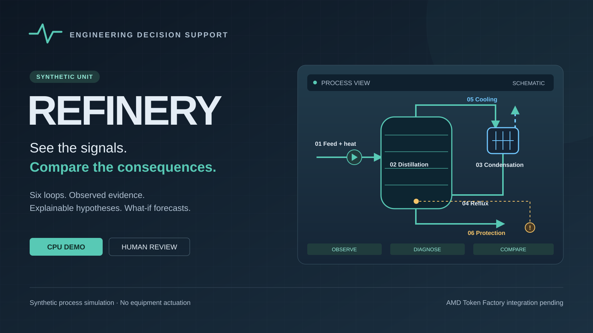

# REFINERY



REFINERY is an engineering prototype for diagnosing disturbances and comparing actions in a **synthetic refinery unit**. It connects a physical process model, observation-based hypotheses, conditional forecasts, and an operator workspace.

Run a scenario, follow the observed evidence, and compare the simulated consequences before reviewing a possible response.

[Explore recorded demo](https://capexnull.github.io/REFINERY-ACT-III/demo/) | [Watch the narrated walkthrough](https://capexnull.github.io/REFINERY-ACT-III/demo.mp4) | [Project page](https://capexnull.github.io/REFINERY-ACT-III/)

The permanent demo is a read-only replay of an actual synthetic CPU calculation. [Live CPU workspace](https://cold-brave-mpegs-nights.trycloudflare.com/industry) is also available while the temporary tunnel host is running.

## Run the CPU demo

Use Python 3.13 and install the dependencies in a virtual environment:

```sh
python -m venv .venv
```

Activate the environment with `.venv\Scripts\Activate.ps1` on Windows PowerShell or `source .venv/bin/activate` on macOS/Linux. Then run:

```sh
python -m pip install -r requirements.txt
python -m amd.server
```

Open **http://127.0.0.1:8765/industry**. No API key is needed for this CPU demo. A fresh checkout starts without calculation history: choose **New calculation** to create a result. The package name `amd` is retained for command compatibility.

## Explore the workspace

- **Six logical loops:** feed and heating, distillation, condensation, reflux return, cooling, and independent protection.
- **Diagnosis:** ranked hypotheses with observed evidence; similarity scores are not calibrated probabilities.
- **What-if actions:** compare hold, restore cooling, reduce heating, and reduce feed under the model's stated assumptions.
- **Review tools:** time-aligned charts, expand all equipment signals, alarms, calculation history, engineering notes, CSV/JSON exports, and printable reports.
- **Video wall:** loop summaries, observed channels, histograms, events, and shared-time trends.
- **Configuration:** English/Russian, light/dark themes, labels, units, and display alarm thresholds.

## Demonstration limits

This prototype models a unit using a synthetic three-component mixture. It is not connected to operating equipment and issues no equipment commands. Imported readings have unverified provenance. Industrial calibration, authenticated plant integration, redundancy, and real-plant validation remain future work. Configurable display thresholds do not change the model's physical protection limits.

The included model bundle supports a limited synthetic A/B/C configuration experiment. Its integrity checks do not establish industrial accuracy or acceptance on other process datasets.

**AMD Token Factory integration verified.** REFINERY successfully called Qwen3.8-27B through AMD Token Factory to explain a diagnostic label. Physical simulation and diagnosis remain CPU-local; GPU execution of the physical simulation is not claimed.

## Contest materials

- [Submission text and status](docs/submission.md)
- [Narrated MP4, 2:28](docs/demo.mp4), [captions](docs/demo.vtt), [transcript](docs/demo-transcript.txt)
- [Verification scope and results](docs/verification.md)
- Presentation: [PDF](docs/presentation.pdf) · [PowerPoint](docs/presentation.pptx) · [interactive HTML](docs/presentation.html).
- [16:9 cover PNG](assets/contest/cover.png)
- [Cover artwork](assets/contest/cover.svg)

The contest entry is proposed for the **Intelligent Industry** track of the [AMD Developer Hackathon — ACT III](https://lablab.ai/ai-hackathons/amd-developer-hackathon-act-iii).

## Container

```sh
docker build -t refinery-act-iii .
docker run --rm -p 127.0.0.1:8765:8765 refinery-act-iii
```

For an explicitly published HTTPS service, set `REFINERY_PUBLIC_ORIGIN` to its exact origin (for example `https://demo.example.org`, without a trailing slash). Local-only startup needs no environment variables.

## Public package provenance

Diagnostic and physical source files and the frozen model retain their original bytes. The public report omits 23 local evidence-path strings; its numerical results are unchanged. The bundle hash is updated for that redacted copy. Public packaging also supplies portable audit locking, an explicit HTTP origin boundary, and relative public status paths. Private research, original journals and private Git history are excluded.

## License

[MIT](LICENSE).
